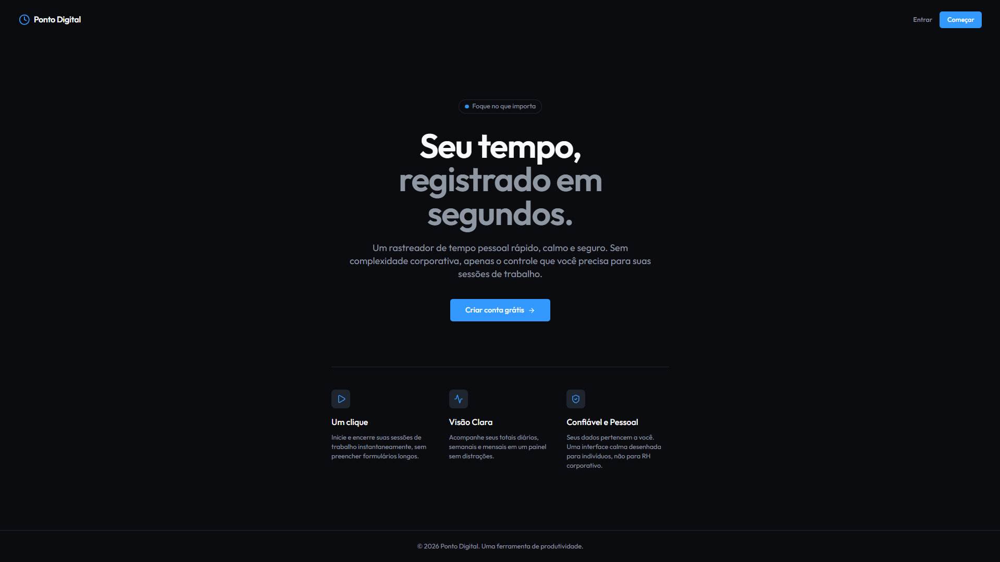

# Ponto Digital

**Seu tempo, registrado em segundos.**

O Ponto Digital é uma aplicação de controle de tempo pessoal criada para tornar o registro da rotina de trabalho simples, rápido e organizado. Com uma experiência direta e sem distrações, cada pessoa pode acompanhar suas sessões, visualizar o tempo investido e manter um histórico claro das suas atividades.

## O produto

Pensado para profissionais que querem entender melhor como utilizam o próprio tempo, o Ponto Digital reúne em um único lugar:

- registro de sessões de trabalho em tempo real;
- organização das atividades por projetos;
- histórico dos registros realizados;
- resumos diários, semanais e mensais;
- acesso individual e seguro para cada usuário.

## Tecnologias

- **Frontend:** React, TypeScript, Vite e Tailwind CSS.
- **Backend:** Node.js, Express e Drizzle ORM.
- **Persistência de dados:** PostgreSQL com Neon.
- **Autenticação:** Clerk.

## Aplicação

Acesse o Ponto Digital em [ponto-digital-vcoelho.onrender.com](https://ponto-digital-vcoelho.onrender.com).
